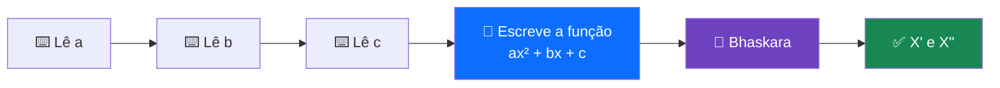
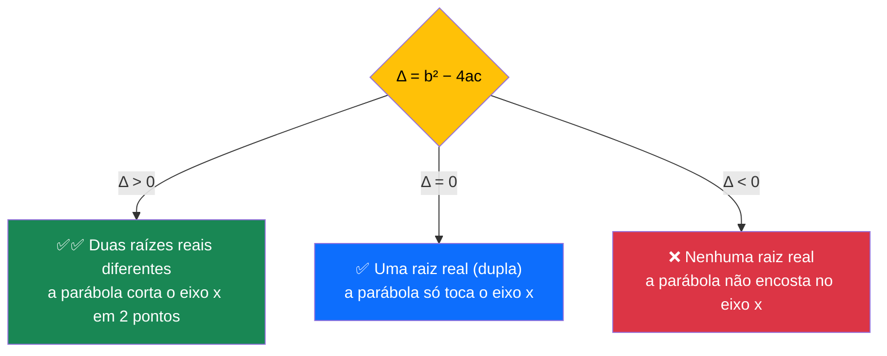
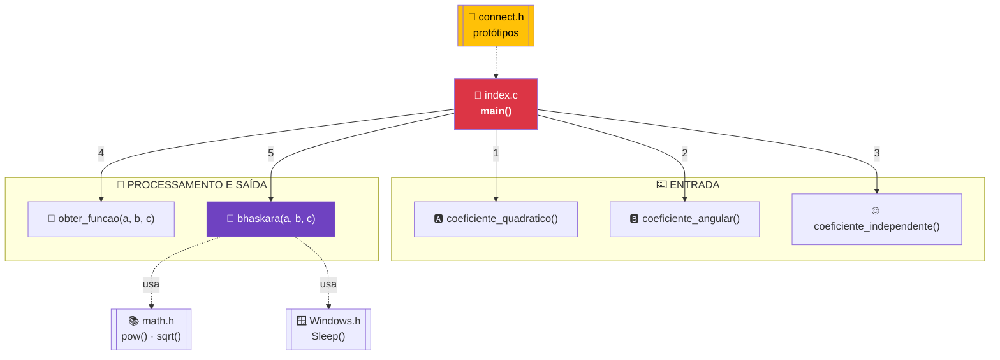
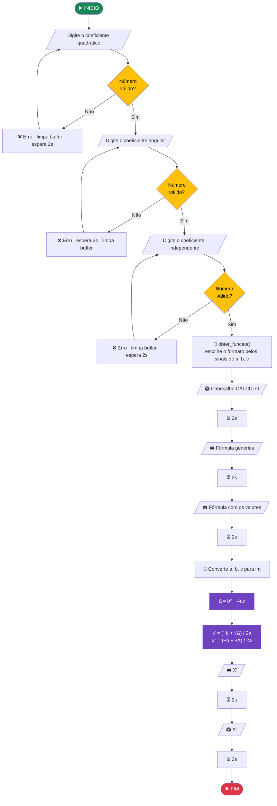
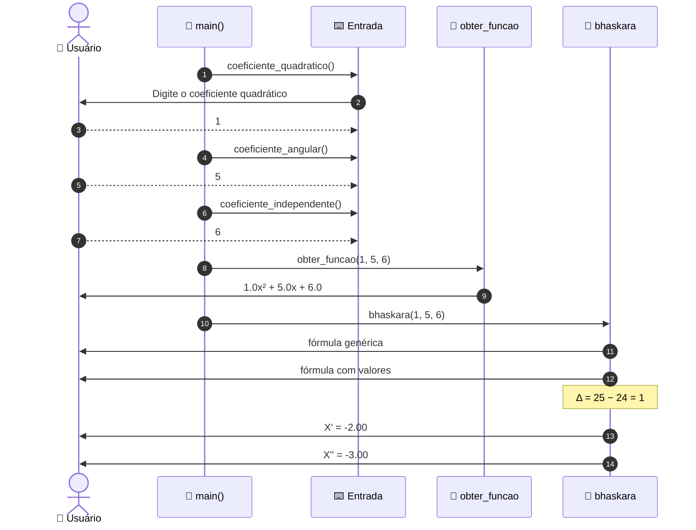
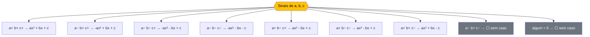
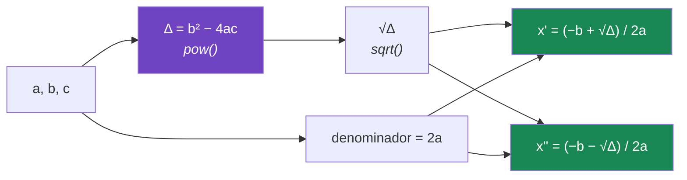

```mermaid
gantt
    title Exibição do cálculo (bhaskara.c)
    dateFormat ss
    axisFormat %Ss
    section Tela
    Cabeçalho CÁLCULO        :a1, 00, 2s
    Fórmula genérica         :a2, after a1, 2s
    Fórmula com valores      :a3, after a2, 2s
    X'                       :a4, after a3, 2s
    X''                      :a5, after a4, 2s
```

<div align="center">

# 📉 Função Quadrática e Fórmula de Bhaskara em C

**Programa de terminal que lê os coeficientes de uma equação do 2º grau, monta a função e encontra suas raízes passo a passo pela Fórmula de Bhaskara**


```
  1.0x² + 5.0x + 6.0

  _______________________________________________
  |-----------------| CÁLCULO |-----------------|
         -b ± √(b² - 4ac)
    x = ──────────────────
               2a

         -5.0 ± √(5.0² - 4(1.0)(6.0))
    x = ──────────────────
               2(1.0)

  X' = -2.00
  X'' = -3.00
```

</div>

---

## 📑 Sumário

1. [Visão geral](#-visão-geral)
2. [A matemática por trás](#-a-matemática-por-trás)
3. [Estrutura do projeto](#-estrutura-do-projeto)
4. [Arquitetura dos módulos](#-arquitetura-dos-módulos)
5. [Como compilar e executar](#-como-compilar-e-executar)
6. [Fluxo de funcionamento](#-fluxo-de-funcionamento)
7. [Os módulos em detalhe](#-os-módulos-em-detalhe)
8. [Teste de mesa completo](#-teste-de-mesa-completo)
9. [Linha do tempo da execução](#-linha-do-tempo-da-execução)
10. [Exemplos de execução](#-exemplos-de-execução)
11. [Pontos de atenção](#-pontos-de-atenção)
12. [Possíveis melhorias](#-possíveis-melhorias)

---

## 🎯 Visão geral

| Item | Descrição |
|---|---|
| **Entrada** | Os três coeficientes `a`, `b` e `c` da equação `ax² + bx + c = 0` |
| **Validação** | Cada leitura repete a pergunta até receber um número |
| **Processamento** | Monta a expressão da função e aplica a Fórmula de Bhaskara |
| **Saída** | A função escrita, a fórmula genérica, a fórmula com os valores substituídos e as raízes `X'` e `X''` |
| **Ritmo** | Pausas de 2 segundos entre cada etapa, como uma apresentação |



---

## 📐 A matemática por trás

### A função quadrática

```
   f(x) = a·x²  +  b·x  +  c
          ─┬─     ─┬─    ┬
           │       │     └── coeficiente independente  (termo sem x)
           │       └──────── coeficiente do termo em x (chamado no código de "angular")
           └──────────────── coeficiente quadrático    (acompanha o x²)
```

| Coeficiente | Nome no código | Função no código | O que ele faz no gráfico |
|:-:|---|---|---|
| `a` | coeficiente quadrático | `coeficiente_quadratico()` | Define se a parábola abre para **cima** (`a > 0`) ou para **baixo** (`a < 0`) |
| `b` | coeficiente angular | `coeficiente_angular()` | Desloca o vértice para os lados |
| `c` | coeficiente independente | `coeficiente_independente()` | Ponto onde a parábola corta o **eixo y** |

### A Fórmula de Bhaskara

```
              ┌──────────────────────────────┐
              │         −b ± √Δ              │
              │   x  =  ────────             │
              │            2a                │
              │                              │
              │   onde   Δ = b² − 4·a·c      │
              └──────────────────────────────┘
```

### 🔑 O papel do Delta (Δ)

O valor de **Δ** decide quantas raízes reais a equação tem:



```
        Δ > 0                     Δ = 0                     Δ < 0

    ╲           ╱             ╲           ╱             ╲           ╱
     ╲         ╱               ╲         ╱               ╲         ╱
  ────●───────●────         ────╲───────╱────              ╲_____╱
       ╲_____╱                   ╲__●__╱               ───────────────
      x'     x''                   x' = x''               sem raízes
```

### Exemplo: `f(x) = x² − 2x − 3` (Δ = 16, raízes −1 e 3)

```
   y
   5 ●               │                               ●
   4  ●●             │                             ●●
   3    ●            │                            ●
   2     ●●          │                          ●●
   1       ●●        │                        ●●
   0 ────────●●──────┼──────────────────────●●────────  x
  -1           ●●    │                    ●●
  -2             ●●● │                 ●●●
  -3                ●●●●           ●●●●
  -4                 │  ●●●●●●●●●●●   ◀ vértice (1, −4)
             ▲                               ▲
           x'=−1                           x''=3
```

---

## 📁 Estrutura do projeto

```
Quadratica/
├── 📘 README.md
├── 📝 runner.txt                    → comando de compilação e execução
├── 🧩 connect.h                     → protótipos de todas as funções
│
├── 🚪 index.c                       → main(): orquestra o programa
│
├── ── ENTRADA ──
├── 🅰️ coeficiente_quadratico.c      → lê o coeficiente a
├── 🅱️ coeficiente_angular.c         → lê o coeficiente b
├── ©️ coeficiente_independente.c    → lê o coeficiente c
│
├── ── PROCESSAMENTO E SAÍDA ──
├── 📝 funcao.c                      → obter_funcao(): escreve ax² + bx + c
├── 🧮 bhaskara.c                    → bhaskara(): calcula e mostra as raízes
│
└── ⚙️ index.exe                     → executável gerado
```

---

## 🧭 Arquitetura dos módulos



O `main()` é curto porque cada responsabilidade está em um arquivo:

```c
int main()
{
    float a = coeficiente_quadratico();      // 1️⃣
    float b = coeficiente_angular();         // 2️⃣
    float c = coeficiente_independente();    // 3️⃣
    obter_funcao(a,b,c);                     // 4️⃣
    bhaskara(a,b,c);                         // 5️⃣
    return 0;
}
```

---

## 🚀 Como compilar e executar

### Pré-requisitos

- **GCC** no Windows (via [MinGW-w64](https://www.mingw-w64.org/) ou [MSYS2](https://www.msys2.org/))
- Terminal **PowerShell**

### Comando (o mesmo do `runner.txt`)

```powershell
clear; chcp 65001; gcc.exe index.c coeficiente_angular.c coeficiente_quadratico.c coeficiente_independente.c bhaskara.c funcao.c -o index.exe; .\index.exe;
```


> 🔤 O `chcp 65001` é necessário para que os símbolos `²`, `√`, `±` e `─` da fórmula apareçam corretamente no console do Windows.

---

## 🔄 Fluxo de funcionamento

### Fluxograma completo



### Interação usuário ↔ programa



---

## 🔬 Os módulos em detalhe

### 1️⃣ Entrada dos coeficientes

Os três arquivos seguem o mesmo padrão:

```c
float coeficiente_angular(void)
{
    static float b;
    printf("Digite o coeficiente ângular: ");
    while(scanf("%f",&b) != 1)              // ← enquanto não ler um número...
    {
        printf("❌ [ERROR] ❌: O número inválido\n");
        Sleep(2000);                        // ← espera 2 segundos
        while(getchar() != '\n');           // ← descarta o que foi digitado
        printf("Digite o coeficiente ângular: ");
    }
    return b;
}
```

```
   Usuário digita "abc"
        │
        ▼
   ┌─────────────────────┐     scanf não consegue ler um float
   │ buffer:  a b c \n   │ ──▶ retorna 0  →  entra no while
   └─────────────────────┘
        │
        ▼  while(getchar() != '\n')
   ┌─────────────────────┐
   │ buffer:  (vazio)    │ ──▶ pronto para nova tentativa
   └─────────────────────┘
```

> 🔑 **Por que limpar o buffer?** Quando o `scanf` falha, o texto inválido **continua no buffer**. Sem o `while(getchar())`, o `scanf` tentaria ler o mesmo `abc` para sempre.

| Arquivo | Condição do `while` | Ordem dentro do erro |
|---|---|---|
| `coeficiente_quadratico.c` | `scanf(...) == 0` | limpa → pergunta → espera |
| `coeficiente_angular.c` | `scanf(...) != 1` | espera → limpa → pergunta |
| `coeficiente_independente.c` | `scanf(...) != 1` | limpa → pergunta → espera |

---

### 2️⃣ Montagem da função · `funcao.c`

A função `obter_funcao()` escolhe o formato da expressão **pela combinação de sinais** de `a`, `b` e `c`:



| `a` | `b` | `c` | Formato usado | Tratado? |
|:-:|:-:|:-:|---|:-:|
| ➕ | ➕ | ➕ | `%.1fx² + %.1fx + %.1f` | ✅ |
| ➖ | ➕ | ➕ | `-%.1fx² + %.1fx + %.1f` | ✅ |
| ➖ | ➖ | ➕ | `-%.1fx² - %.1fx + %.1f` | ✅ |
| ➖ | ➖ | ➖ | `-%.1fx² - %.1fx - %.1f` | ✅ |
| ➕ | ➖ | ➕ | `%.1fx² - %.1fx + %.1f` | ✅ |
| ➕ | ➖ | ➖ | `%.1fx² - %.1fx + %.1f` | ✅ |
| ➕ | ➕ | ➖ | `%.1fx² + %.1fx - %.1f` | ✅ |
| ➖ | ➕ | ➖ | — | ⚪ |
| qualquer um `0` | | | — | ⚪ |

> ⚠️ Os sinais escritos no formato se somam ao sinal do próprio número, o que gera sinais duplos na tela (veja os [pontos de atenção](#-pontos-de-atenção)).

---

### 3️⃣ Cálculo das raízes · `bhaskara.c`

#### Etapa A: apresentação visual da fórmula

```
_________________________________________________________________________________________
|--------------------------------------| CÁLCULO |--------------------------------------|
                                         ⏳ 2s
       -b ± √(b² - 4ac)
  x = ──────────────────                 ← fórmula genérica
             2a
                                         ⏳ 2s
       -5.0 ± √(5.0² - 4(1.0)(6.0))
  x = ──────────────────                 ← mesma fórmula com os valores digitados
             2(1.0)
                                         ⏳ 2s
```

#### Etapa B: conversão para inteiro

```c
int coeficiente_quadratico   = a;   // float → int
int coeficiente_angular      = b;
int coeficiente_independente = c;
```

```
   float a = 1.5   ──▶   int = 1     (as casas decimais são descartadas)
   float b = 5.0   ──▶   int = 5
```

#### Etapa C: o cálculo

```c
float delta       = pow(coeficiente_angular, 2) - (4 * coeficiente_quadratico * coeficiente_independente);
float denominador = 2 * coeficiente_quadratico;
float x_1 = ((coeficiente_angular * -1) + (sqrt(delta))) / denominador;
float x_2 = ((coeficiente_angular * -1) - (sqrt(delta))) / denominador;
```



> 💡 Repare no `coeficiente_angular * -1`: é o **−b** da fórmula. O mesmo `√Δ` é **somado** para gerar `x'` e **subtraído** para gerar `x''`: é o **±** da fórmula, dividido em dois cálculos.

---

## 📋 Teste de mesa completo

Entrada: **a = 1 · b = 5 · c = 6**, ou seja, `x² + 5x + 6 = 0`

| Passo | Operação | Conta | Resultado |
|:-:|---|:--|:-:|
| 1 | Conversão para `int` | `1.0 → 1`, `5.0 → 5`, `6.0 → 6` | `1, 5, 6` |
| 2 | `b²` | `pow(5, 2)` | `25` |
| 3 | `4ac` | `4 · 1 · 6` | `24` |
| 4 | **Δ** | `25 − 24` | **`1`** |
| 5 | `√Δ` | `sqrt(1)` | `1` |
| 6 | `−b` | `5 · −1` | `−5` |
| 7 | `2a` | `2 · 1` | `2` |
| 8 | **x'** | `(−5 + 1) / 2` | **`−2`** |
| 9 | **x''** | `(−5 − 1) / 2` | **`−3`** |

```
                 −5 ± √1          −5 ± 1         ┌──▶  (−5 + 1) / 2 = −4 / 2 = −2   →  X'
         x  =  ──────────   =   ────────   ──────┤
                   2                2            └──▶  (−5 − 1) / 2 = −6 / 2 = −3   →  X''
```

**Conferindo:** `(−2)² + 5(−2) + 6 = 4 − 10 + 6 = 0` ✅ · `(−3)² + 5(−3) + 6 = 9 − 15 + 6 = 0` ✅

### Memória dentro de `bhaskara()`

```
   ┌──────────────────────────┬─────────┐
   │ a, b, c (float)          │ 1, 5, 6 │
   ├──────────────────────────┼─────────┤
   │ coeficiente_quadratico   │    1    │
   │ coeficiente_angular      │    5    │
   │ coeficiente_independente │    6    │
   ├──────────────────────────┼─────────┤
   │ delta                    │   1.0   │
   │ denominador              │   2.0   │
   │ x_1                      │  -2.0   │
   │ x_2                      │  -3.0   │
   └──────────────────────────┴─────────┘
```

---

## 🕒 Linha do tempo da execução

O `Sleep(2000)` cria pausas de **2 segundos** para o cálculo aparecer em etapas, como uma apresentação. Depois da última entrada, a execução leva cerca de **10 segundos**:

```
 0s       2s       4s       6s       8s       10s
 │────────│────────│────────│────────│────────│
 ▼        ▼        ▼        ▼        ▼        ▼
 CÁLCULO  fórmula  fórmula  X'       X''      fim
          genérica com                  
                   valores  
```



---

## 💻 Exemplos de execução

Resultados reais do programa compilado:

| a | b | c | Δ | Função exibida | X' | X'' | Situação |
|:-:|:-:|:-:|:-:|:--|:-:|:-:|:-:|
| 1 | 5 | 6 | 1 | `1.0x² + 5.0x + 6.0` | −2.00 | −3.00 | ✅ |
| 2 | 0 | −8 | 64 | *(não exibida)* | 2.00 | −2.00 | ✅ raízes · ⚠️ função |
| −1 | 2 | 3 | 16 | `--1.0x² + 2.0x + 3.0` | −1.00 | 3.00 | ✅ raízes · ⚠️ função |
| 1 | −5 | 6 | 1 | `1.0x² - -5.0x + 6.0` | 3.00 | 2.00 | ✅ raízes · ⚠️ função |
| 1 | −2 | 1 | 0 | `1.0x² - -2.0x + 1.0` | 1.00 | 1.00 | ✅ raiz dupla · ⚠️ função |
| 1 | 2 | 5 | −16 | `1.0x² + 2.0x + 5.0` | nan | nan | ❌ |
| 0 | 2 | 4 | 4 | *(não exibida)* | nan | -inf | ❌ |
| 1.5 | −3.5 | 2 | 0.25 | `1.5x² - -3.5x + 2.0` | 2.00 | 1.00 | ❌ (certo: 1.33 e 1.00) |

### Saída completa (`a = 1`, `b = 5`, `c = 6`)

```console
Digite o coeficiente quadrático: 1
Digite o coeficiente ângular: 5
Digite o coeficiente independente: 6


1.0x² + 5.0x + 6.0

_________________________________________________________________________________________
|--------------------------------------| CÁLCULO |--------------------------------------|
       -b ± √(b² - 4ac)
  x = ──────────────────
             2a

       -5.0 ± √(5.0² - 4(1.0)(6.0))
  x = ──────────────────
             2(1.0)

X' = -2.00
X'' = -3.00
```

---

## 🚨 Pontos de atenção

Encontrados compilando e executando o código com vários conjuntos de coeficientes.

| # | Situação | Onde | Efeito |
|:-:|---|---|---|
| 1 | **Coeficientes decimais são truncados** | `bhaskara.c` · conversão para `int` | `1.5x² − 3.5x + 2` é resolvida como `x² − 3x + 2`: raízes **erradas** |
| 2 | **Δ negativo** | `bhaskara.c` · `sqrt(delta)` | Mostra `nan` em vez de avisar que não há raízes reais |
| 3 | **`a = 0`** | `bhaskara.c` · divisão por `2a` | Divisão por zero (`nan` / `inf`). A equação vira do 1º grau: `x = −c/b` |
| 4 | **Sinal duplo na função** | `funcao.c` | `-%.1f` com `a` negativo vira `--1.0x²`; `- %.1f` com `b` negativo vira `- -5.0x` |
| 5 | **`+ c` negativo** | `funcao.c` · caso `a+ b− c−` | Mostra `+ -6.0` |
| 6 | **Combinações sem caso** | `funcao.c` | `a− b+ c−` ou qualquer coeficiente `0` não imprime a função |
| 7 | **Sinal duplo na fórmula** | `bhaskara.c` · `"-%.1f"` | Com `b` negativo, aparece `--5.0` e `-5.0²` (deveria ser `(−5.0)²`) |
| 8 | Fim da entrada (EOF) | `coeficiente_angular.c` / `coeficiente_independente.c` | Se a entrada acabar, o `while(getchar() != '\n')` nunca encontra o `\n` e o programa trava em laço infinito |

### 🔴 Demonstração do ponto 1

```
   Digitado:      a = 1.5    b = −3.5    c = 2.0
                    │           │          │
            (int)   ▼           ▼          ▼
   Usado:         a = 1      b = −3      c = 2

   Equação real:     1.5x² − 3.5x + 2 = 0   →  Δ = 0.25  →  x' = 1.33  x'' = 1.00
   Equação usada:      x² − 3x   + 2 = 0   →  Δ = 1     →  x' = 2.00  x'' = 1.00  ❌
```

A correção é usar os próprios valores `float` no cálculo, sem a conversão para `int`.

### 🔴 Demonstração do ponto 4

```
   a = −1   →   printf("-%.1fx²", a)   →   "-" + "-1.0" + "x²"   →   --1.0x²   ❌
   b = −5   →   printf("- %.1fx", b)   →   "- " + "-5.0" + "x"   →   - -5.0x   ❌
```

A solução é imprimir o **sinal** e o **valor absoluto** (`fabs`) separadamente:

```c
printf("%.1fx² %c %.1fx %c %.1f\n",
       a,
       b < 0 ? '-' : '+', fabs(b),
       c < 0 ? '-' : '+', fabs(c));
```

Com uma única linha, todas as combinações de sinais, inclusive com zeros, ficam corretas e a cadeia de `if/else` deixa de ser necessária.

---

## 🛠️ Possíveis melhorias

| # | Melhoria | Benefício |
|:-:|---|---|
| 1 | Remover a conversão para `int` em `bhaskara.c` | Raízes corretas com coeficientes decimais |
| 2 | Verificar `Δ < 0` antes do `sqrt` | Mensagem clara: "não possui raízes reais" |
| 3 | Tratar `a = 0` como equação do 1º grau | Evita divisão por zero e resolve `x = −c/b` |
| 4 | Substituir a cadeia de `if/else` de `funcao.c` por uma linha com `fabs` | Cobre todas as combinações de sinais |
| 5 | Mostrar o valor de **Δ** na tela | Torna o passo a passo mais didático |
| 6 | Mostrar o **vértice** `(−b/2a, −Δ/4a)` e a concavidade | Descreve a parábola por completo |
| 7 | Tratar `EOF` nos laços de leitura | Evita laço infinito |
| 8 | Renomear "coeficiente angular" para "coeficiente linear" ou "coeficiente b" | Nome mais preciso para a função quadrática |
| 9 | Remover `stdlib.h`, `stdbool.h` e `string.h` | Não são utilizadas |

<details>
<summary><b>👉 Clique para ver uma versão de funcao.c e bhaskara.c com as melhorias aplicadas</b></summary>

#### `funcao.c`

```c
#include <stdio.h>
#include <math.h>

void obter_funcao(float a, float b, float c)
{
    printf("\n\n%.1fx² %c %.1fx %c %.1f\n\n",
           a,
           b < 0 ? '-' : '+', fabs(b),
           c < 0 ? '-' : '+', fabs(c));
}
```

#### `bhaskara.c`

```c
#include <stdio.h>
#include <math.h>
#include <Windows.h>

void bhaskara(float a, float b, float c)
{
    printf("_________________________________________________________________________________________\n");
    printf("|--------------------------------------| CÁLCULO |--------------------------------------|\n");
    Sleep(2000);
    printf("       -b ± √(b² - 4ac)\n");
    printf("  x = ──────────────────\n");
    printf("             2a\n\n");
    Sleep(2000);
    printf("       -(%.1f) ± √((%.1f)² - 4(%.1f)(%.1f))\n", b, b, a, c);
    printf("  x = ──────────────────\n");
    printf("             2(%.1f)\n\n", a);
    Sleep(2000);

    if (a == 0) {
        if (b == 0) {
            printf("❌ Não é uma equação (a = 0 e b = 0).\n");
        } else {
            printf("⚠️  a = 0: equação do 1º grau\n");
            printf("X = %.2f\n", -c / b);
        }
        return;
    }

    float delta = b * b - 4 * a * c;
    printf("Δ = %.2f\n", delta);
    Sleep(2000);

    if (delta < 0) {
        printf("❌ Δ < 0: a equação não possui raízes reais.\n");
        return;
    }

    float x_1 = (-b + sqrtf(delta)) / (2 * a);
    float x_2 = (-b - sqrtf(delta)) / (2 * a);

    if (delta == 0) {
        printf("X' = X'' = %.2f  (raiz dupla)\n", x_1);
    } else {
        printf("X' = %.2f\n", x_1);
        Sleep(2000);
        printf("X'' = %.2f\n", x_2);
    }
    Sleep(2000);
}
```

</details>

---

<div align="center">

**Projeto em C para estudo de modularização, validação de entrada, `math.h` e equações do 2º grau** 📚

`index.c` · `connect.h` · 5 módulos · `x = (−b ± √Δ) / 2a` 🧮

</div>